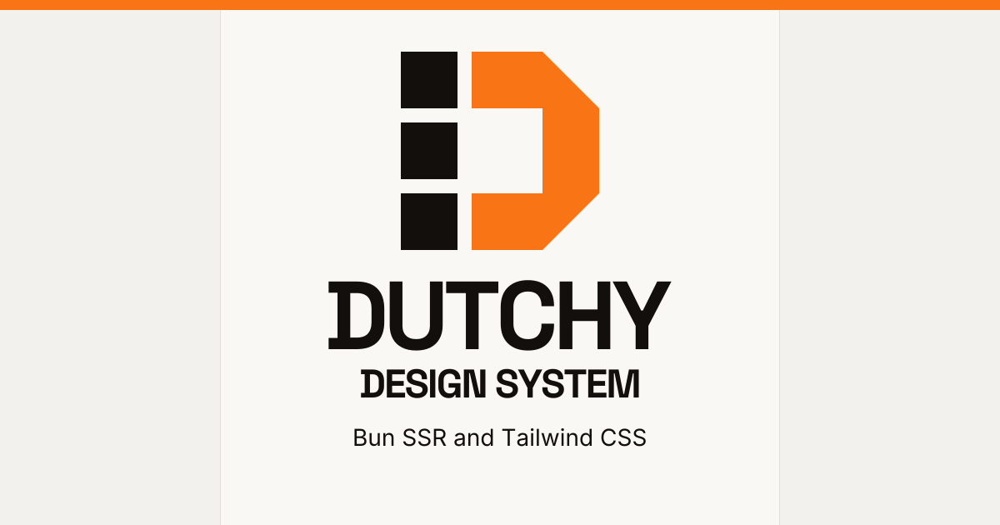

[](https://dutchy.design)

# Dutchy Design System — Bun SSR and Tailwind CSS Components

Dutchy is a Dutch-inspired design system and TypeScript/JSX component library for server-rendered web applications built with Bun and Tailwind CSS 4. It includes reusable UI components, design tokens, themes, and complete page examples, with vanilla JavaScript interactivity and no client-side React runtime.

Sharp geometry, zero-radius corners, warm orange accents, and bold typography give dashboards, forms, storefronts, and documentation a consistent visual language.

[Live documentation](https://dutchy.design) · [Component gallery](https://dutchy.design/components) · [Layout patterns](https://dutchy.design/patterns) · [Page examples](https://dutchy.design/showcase) · [Bun integration guide](https://dutchy.design/bun)

## Why Use Dutchy

- **Typed SSR components:** Compose interfaces with TypeScript and JSX, rendered to HTML on the server through `react-dom/server`.
- **Vanilla JavaScript behavior:** Add tabs, dialogs, dropdowns, form validation, and other interactions through small scripts and stable `data-*` selectors.
- **Shared design tokens:** Use Tailwind CSS 4 utilities and CSS custom properties for colors, typography, spacing, and themes.
- **Reusable layouts and examples:** Explore full-page compositions alongside individual component demos and static HTML examples.
- **Distinct visual style:** Apply sharp borders, high contrast, Space Grotesk display text, Inter body text, and JetBrains Mono code typography.

## UI Components and Design Foundations

| Area | Included examples | Explore |
|------|-------------------|---------|
| Forms and inputs | Form fields, selects, checkboxes, radio buttons, textareas, file uploads, and signature drawing | [Forms](https://dutchy.design/components/forms), [File upload](https://dutchy.design/components/fileupload), [Scribble](https://dutchy.design/components/scribble) |
| Navigation | Menus, dropdowns, tabs, breadcrumbs, pagination, and multi-step flows | [Menus](https://dutchy.design/components/menu), [Tabs](https://dutchy.design/components/tabs), [Stepper](https://dutchy.design/components/stepper) |
| Feedback and overlays | Alerts, toast notifications, modals, drawers, skeletons, spinners, and progress indicators | [Alerts](https://dutchy.design/components/alerts), [Modals and drawers](https://dutchy.design/components/modals), [Progress](https://dutchy.design/components/progress) |
| Data and content | Sortable tables, cards, badges, images, and statistics | [Data tables](https://dutchy.design/components/datatable), [Cards](https://dutchy.design/components/cards), [Statistics](https://dutchy.design/components/stats) |
| Design foundations | Color tokens, typography, spacing, flexible layouts, and themes | [Colors](https://dutchy.design/colors), [Typography](https://dutchy.design/typography), [Themes](https://dutchy.design/showcase/themes) |

Browse the [complete component gallery](https://dutchy.design/components) or read the [design token documentation](./docs/01-design-system/tokens/README.md).

## Example Applications and Use Cases

- **Dashboards and internal tools:** Start with the [admin dashboard](https://dutchy.design/showcase/admin) and [data management](https://dutchy.design/showcase/data) examples.
- **Forms and onboarding:** Explore [contact forms](https://dutchy.design/showcase/contact), [login](https://dutchy.design/showcase/login), and a [registration wizard](https://dutchy.design/showcase/register).
- **Storefronts and product pages:** Use the [category listing](https://dutchy.design/showcase/categories), [pricing page](https://dutchy.design/showcase/pricing), and [shopping cart](https://dutchy.design/showcase/cart) compositions.
- **Content and marketing sites:** Combine [blog layouts](https://dutchy.design/showcase/blog) with shared typography, navigation, and [page patterns](https://dutchy.design/patterns).

These showcases demonstrate UI composition and interaction patterns; adapt their handlers and data to your application.

## Quick Start

```bash
bun install
bun run dev:css   # watch Tailwind CSS
bun run dev       # start Bun server (watch mode)
```

Open `http://localhost:3000`

## What’s In This Repo

- **Bun SSR app** (for demos/showcases): routes in `src/routes/`, server in `src/index.ts`
- **JSX SSR components**: reusable building blocks in `src/components/` (no client-side React)
- **Design tokens + docs**: Markdown docs in `docs/`
- **Static assets**: `public/assets/` (generated CSS + vanilla JS modules)

## Stack

- **Runtime**: [Bun](https://bun.sh)
- **Rendering**: React SSR via `renderToReadableStream()` (no hydration)
- **Styling**: Tailwind CSS 4 + CSS-first design tokens
- **Routing**: file-based (see `src/utils/loadRoutes.ts`)
- **Interactivity**: vanilla JS modules + `data-*` hooks (see `public/assets/js/`)

## SSR-Only JSX (Important)

Components in `src/components/` render to static HTML on the server. There is **no React runtime** in the browser.

- Don’t use React hooks (`useState`, `useEffect`, …)
- Don’t rely on JSX event handlers (`onClick`, `onChange`, …) for behavior
- For interactive components (tabs, modal, toast, file upload, …) load a small script from `public/assets/js/` and bind via `data-*`

## Local Demo Routes

- `/` — home
- `/components` — component gallery (driven by `src/components/componentRegistry.ts`)
- `/components/<id>` — component demo pages (implemented as routes in `src/routes/components/`)
- `/showcase` — full-page compositions
- `/patterns` — patterns gallery
- `/typography`, `/colors` — foundation pages

## Project Structure

```text
src/
  index.ts                  # Bun server entry
  components/               # JSX SSR components (folder-per-component)
  routes/                   # File-based routing (index.tsx + method files)
  middleware/               # Request helpers (e.g. CORS)
  utils/                    # Routing + static asset helpers
  styles/dutchy.css          # Tailwind source (tokens + theme vars)
public/assets/
  css/styles.css            # Generated Tailwind output (build artifact)
  js/                       # Vanilla JS modules (tabs, modal, toast, ...)
docs/                       # Design system docs (tokens/components/patterns)
.claude/skills/             # Claude Code project skills
.agents/skills/             # Codex project skills
```

## Routing Conventions

Routes are discovered under `src/routes/`:

- `index.tsx` → `GET` handler (React component or `(req) => Response`)
- `get.ts`, `post.ts`, `put.ts`, … → explicit HTTP method handlers
- `$param` folder names are supported by the router (become `:param`), even if your current routes are mostly static

## Theming

Themes are CSS variables (default, purple, crimson). Tailwind utilities (`bg-primary`, `text-primary`, `border-primary`, including opacity modifiers) follow the active theme.

For the complete flow from Tailwind source to runtime theme switching and Bun static asset serving, see [Theme and CSS Build Lifecycle](./docs/03-using-with-bun/theme-and-css-build.md).

## Tooling Notes

- Tailwind 4 is configured in `src/styles/dutchy.css` with `@import "tailwindcss"`, `@source`, and `@theme`. There is no required `tailwind.config.js` for the app.
- `public/assets/css/styles.css` is generated by `bun run build:css` and is intentionally not tracked.
- Renovate is configured to create update branches and PRs against `develop` only.
- Claude Code project skills live in `.claude/skills/`; Codex project skills live in `.agents/skills/`.
- `.claude/settings.local.json` stays ignored because it is machine-local.

## Scripts

| Script | Description |
|--------|-------------|
| `bun run dev` | Start Bun server in watch mode |
| `bun run dev:css` | Watch and rebuild Tailwind CSS |
| `bun run build` | Build generated assets |
| `bun run build:css` | One-time Tailwind CSS build (minified) |
| `bun run typecheck` | Run TypeScript without emitting files |
| `bun run lint` | Run Biome format, lint, and import checks |
| `bun run lint:fix` | Apply Biome safe fixes |
| `bun test` | Run tests in `tests/` |

## Docker

```bash
docker build -t dutchy:2.1.2 .
docker run -p 3000:3000 dutchy:2.1.2
```

The image builds Tailwind CSS at build time and serves the Bun SSR app on port 3000.

## Documentation

- [Design system documentation](./docs/01-design-system/README.md) — design principles, tokens, components, and HTML-first patterns
- [Bun SSR guide](./docs/03-using-with-bun/README.md) — setup, routing, components, and server conventions
- [Static HTML showcases](./docs/02-html-showcase/README.md) — complete HTML page examples
- [JSX component source](./src/components/) — the shared component implementation used by the demo app

## Search Engine Discovery

The live site uses canonical URLs under `https://dutchy.design`, publishes [robots.txt](https://dutchy.design/robots.txt) to allow all crawlers, and generates an automatic [XML sitemap](https://dutchy.design/sitemap.xml) of its public pages.

See [Canonical URLs and Crawl Access](./docs/03-using-with-bun/seo.md) for configuration and verification.

## License

MIT
